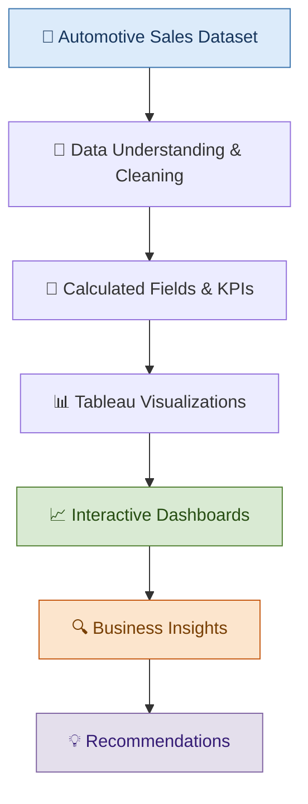

# 🚗 Automotive Sales Analytics | Tableau Dashboard

**Turning Automotive Sales Data into Actionable Business Insights**

An end-to-end Business Analyst project exploring sales performance, customer behaviour, dealer performance, and vehicle preferences using Tableau.

---

## 📌 Project Overview

The objective of this project is to analyse automobile sales data and provide meaningful insights into revenue trends, regional performance, dealer rankings, product popularity, and customer purchasing behaviour.

Using **Tableau**, I transformed raw sales data into interactive dashboards that help stakeholders explore key performance indicators (KPIs), compare business performance, and identify opportunities for better sales planning and decision-making.

This project was completed as part of my **Business Analyst training with CoachX.Live**.

## 🎯 Business Objectives

* Monitor overall revenue and vehicle sales performance.
* Identify sales trends and seasonal patterns.
* Compare revenue performance across regions and dealers.
* Understand popular car manufacturers, models, and body styles.
* Explore customer demographics and purchasing behaviour.
* Build interactive dashboards with filters for deeper analysis.
* Translate analytical findings into actionable business recommendations.

## 🛠️ Tools & Technologies

| Tool / Concept       | Purpose                                       |
| -------------------- | --------------------------------------------- |
| Tableau              | Data visualization and interactive dashboards |
| CSV Dataset          | Source data for analysis                      |
| Calculated Fields    | Create analytical dimensions and measures     |
| Parameters & Filters | Enable interactive data exploration           |
| Business Analysis    | Identify trends and recommend actions         |

## 📊 Project at a Glance

| Metric            |                       Result |
| ----------------- | ---------------------------: |
| Total Revenue     |                  **$671.5M** |
| Total Cars Sold   |                   **23,906** |
| Average Car Price |                  **$28,090** |
| Car Manufacturers |                           30 |
| Car Models        |                          154 |
| Dealers           |                           28 |
| Regions           |                            7 |
| Analysis Period   | January 2022 – December 2023 |

*Figures are based on the project dataset and the accompanying insights report.*

## 🗺️ Project Workflow

## 📊 Dashboard Overview

### 1. Executive Sales Overview

**Purpose:** Understand overall sales performance at a glance.

Key components:

* Total Revenue KPI
* Total Cars Sold KPI
* Average Car Price KPI
* Monthly sales and revenue trends
* Revenue comparison by region
* Interactive filters for exploring the data

**Business question:** How is the business performing, and when and where are sales strongest?

### 2. Customer Behaviour

**Purpose:** Explore customer demographics and vehicle preferences.

Key components:

* Annual Income vs. Sale Price scatter plot
* Vehicle sales by body style and gender
* Body style distribution donut chart
* Interactive customer and product filters

**Business question:** What patterns can help the business better understand its customers and their vehicle preferences?

### 3. Dealer & Product Performance

**Purpose:** Evaluate dealer performance and product demand.

Key components:

* Top dealers ranked by revenue
* Adjustable Top N Dealers parameter
* Top 10 car models
* Transmission preference analysis
* Interactive product and regional filters

**Business question:** Which dealers generate the most revenue, and which products attract the most demand?

## 💡 Key Business Insights

### 📈 1. Revenue and Sales Grew in 2023

* Revenue increased from approximately **$300.3M in 2022 to $371.2M in 2023**, a growth of 23.6%.
* Cars sold increased from 10,645 to 13,261, a growth of 24.6%.

**Recommendation:** Investigate the factors behind this growth and use them to inform future sales targets and resource planning.

### 📅 2. Sales Show Seasonal Patterns

September, November, and December together accounted for approximately **43% of total cars sold and revenue** across the two-year period.

**Recommendation:** Prepare inventory, staffing, and promotional campaigns ahead of the stronger sales months.

### 🌎 3. Austin Leads Regional Revenue

Austin generated approximately **$117.2M in revenue**, representing around 17.5% of total revenue.

**Recommendation:** Examine Austin's sales mix and operating practices to identify approaches that could be tested in other regions.

### 🏢 4. Dealer Revenue Varies Significantly

The top 10 dealers collectively contributed approximately **53% of total revenue**. Rabun Used Car Sales led in revenue, while Progressive Shippers Cooperative Association No. led in vehicle volume with 1,318 cars sold.

**Recommendation:** Compare dealer-level revenue, sales volume, and product mix to understand performance differences.

*These findings are drawn from the accompanying project report. The observations identify patterns in the dataset; they do not establish the causes behind those patterns.*

## 🧮 Data Preparation & Tableau Calculations

The project included data checks, calculated fields, KPI creation, and interactive controls.

Examples of analytical fields and calculations:

* **Revenue:** `SUM([Price ($)])`
* **Cars Sold:** `COUNT([Car_id])`
* **Average Car Price:** `AVG([Price ($)])`
* **Income Group:** Categorizes customers into low-, middle-, and high-income groups using the project's defined thresholds.
* **Sale Category:** Labels transactions as Standard Sale or Premium Sale based on a $30,000 price threshold.
* **Date Analysis:** Year, quarter, and month breakdowns.
* **Dealer Ranking:** Parameter-driven Top N dealer analysis.
* **Model Ranking:** Top 10 models analysis.

Data preparation also included checking transaction IDs, reviewing missing values, correcting an engine-type encoding issue, and preparing date fields for analysis.

> **Note:** The Premium Sale classification is a price category, not a profit calculation. The dataset does not establish vehicle costs or profit margins.

## 📁 Repository Contents

| File                    | Description                                                                          |
| ----------------------- | ------------------------------------------------------------------------------------ |
| `Car Sales project.twb` | Tableau workbook containing the project visualizations and dashboards                |
| `Car Sales Project.pdf` | Project report containing the methodology, dashboard overview, and business insights |
| `README.md`             | Project documentation                                                                |

*The workbook may require the original CSV dataset and a valid data source path to refresh or display correctly on another computer.*

## 🚀 How to Explore the Project

1. Download the Tableau workbook and PDF report from this repository.
2. Open the workbook in Tableau Desktop.
3. If prompted, reconnect the workbook to the original automotive sales CSV dataset.
4. Review the dashboards and interact with available filters and parameters.
5. Read the PDF report to understand the findings and recommendations.

## 🎓 Key Learnings

Through this project, I practised:

* Analysing business data and identifying trends.
* Building KPI-driven Tableau dashboards.
* Creating calculated fields and parameters.
* Using filters for interactive analysis.
* Comparing regional, dealer, and product performance.
* Communicating data findings through business insights and recommendations.

## 👨‍💻 About Me

I'm a Business Analyst graduate building practical skills in data analysis, visualization, and business intelligence.

**Tools I'm developing skills in:** Excel | SQL | Tableau | Power BI

This project reflects my learning journey to transform raw data into meaningful business insights.

## 🔗 Connect With Me

* **LinkedIn:** [(https://www.linkedin.com/in/kaifsayyed7)]
* **GitHub:** [Explore my other projects](https://github.com/)

---

⭐ If you find this project useful, feel free to explore the files and share your feedback.

*Created as part of my Business Analyst training with CoachX.Live.*
